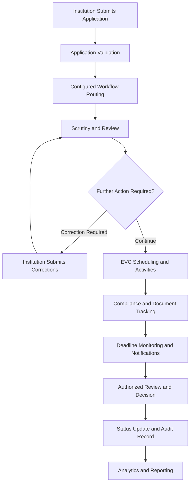
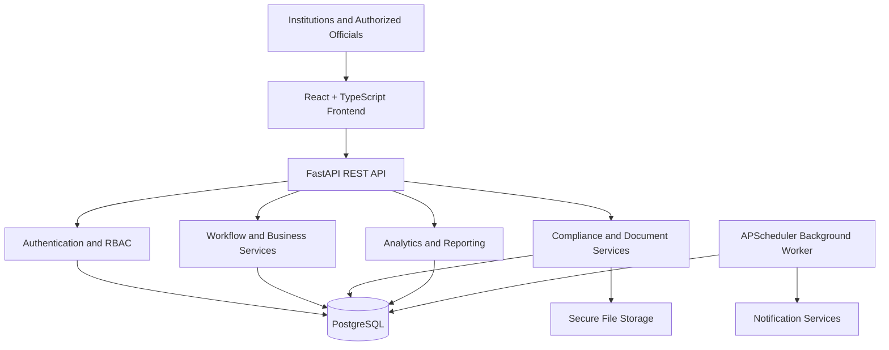

# NiyamSetu — AICTE Approval Workflow & Institutional Compliance Platform

<p align="center">
  <strong>Connecting Institutions, Approvals, Compliance, and Accountability</strong>
</p>

<p align="center">
  A secure, configurable digital platform for streamlining AICTE approval-related workflows, monitoring institutional compliance, and improving administrative transparency.
</p>

---

## Table of Contents

- [Overview](#overview)
- [Problem Statement](#problem-statement)
- [Our Solution](#our-solution)
- [Key Features](#key-features)
- [Application Workflow](#application-workflow)
- [User Roles](#user-roles)
- [System Architecture](#system-architecture)
- [Technology Stack](#technology-stack)
- [Project Structure](#project-structure)
- [Getting Started](#getting-started)
- [Environment Configuration](#environment-configuration)
- [Database Setup](#database-setup)
- [Running the Application](#running-the-application)
- [Testing and Validation](#testing-and-validation)
- [Security and Data Protection](#security-and-data-protection)
- [Expected Impact](#expected-impact)
- [Limitations and Scope](#limitations-and-scope)
- [Future Scope](#future-scope)
- [Contributing](#contributing)
- [Team](#team)
- [License](#license)

---

## Overview

**NiyamSetu** is an integrated, secure, and configurable digital platform designed to support AICTE approval-related workflows and institutional compliance management.

The platform brings application tracking, workflow routing, Expert Visit Committee (EVC) management, undertaking tracking, document validity monitoring, deadline reminders, escalations, analytics, and audit records into a centralized system.

By connecting institutions and authorized officials through role-based dashboards and structured workflows, NiyamSetu aims to reduce manual follow-ups, improve visibility into pending tasks, and support more accountable administrative operations.

NiyamSetu is designed to assist the approval process, not replace the statutory authority of officials responsible for scrutiny, verification, inspections, or final decisions.

## Problem Statement

Approval-related processes involve multiple stakeholders, document submissions, scrutiny stages, committee visits, compliance requirements, and deadlines.

When these activities are managed through disconnected systems or manual tracking, several challenges can arise:

- **Fragmented application tracking:** Application information and status updates may be spread across multiple records or communication channels.
- **Limited visibility:** Institutions and officials may find it difficult to identify the current stage, assigned responsibility, or pending action.
- **Manual follow-ups:** Tracking deadlines, overdue tasks, and compliance requirements can require repeated administrative effort.
- **Document validity challenges:** Expiring, missing, or outdated documents may be difficult to monitor systematically.
- **Coordination difficulties:** Institutions, scrutiny officers, regional officers, and committee members need a structured way to coordinate activities.
- **Reporting overhead:** Preparing consolidated reports and identifying workflow bottlenecks can require manual data collection.
- **Auditability concerns:** Important actions and workflow changes need consistent, traceable records.

These challenges motivate the need for a unified platform that improves visibility, coordination, compliance monitoring, and accountability.

## Our Solution

NiyamSetu provides a centralized workflow and compliance management system built around configurable processes, secure access, and traceable operations.

The platform supports:

1. Digital application submission and tracking.
2. Configurable workflow stages and authorized transitions.
3. Role-based dashboards and task assignments.
4. Stage-wise pendency monitoring.
5. EVC scheduling, assignments, and report workflows.
6. Undertaking issuance, evidence submission, and review.
7. Document expiry and renewal monitoring.
8. Deadline reminders and configurable escalation rules.
9. Analytics, reports, and structured exports.
10. Audit records for important actions and configuration changes.

The objective is to provide institutions and authorized officials with a clearer view of the approval lifecycle while preserving existing statutory responsibilities.

## Key Features

### 1. Configurable Workflow Management

- Configurable application stages and routing rules.
- Controlled workflow transitions.
- Role-aware task assignment.
- Versioned workflow configuration.
- Application status and stage history.
- Traceable workflow actions.

### 2. Role-Based Dashboards

Provide relevant information and permitted actions according to the user's role.

- Institution dashboard
- Scrutiny officer dashboard
- Regional officer dashboard
- Bureau officer dashboard
- Committee member dashboard
- Senior authority dashboard
- Administrator dashboard

### 3. Application and Pendency Tracking

- View application status and workflow progress.
- Identify pending applications and assigned tasks.
- Track stage-wise pendency.
- Monitor overdue activities.
- Support filtering and structured reporting.
- Maintain a traceable application history.

### 4. EVC Management

Support Expert Visit Committee-related administrative activities, including:

- Visit scheduling and management.
- Committee assignments.
- Visit-related reports.
- Workflow status tracking.
- Related notifications and follow-up activities.

### 5. Undertaking and Compliance Management

- Manage undertaking conditions.
- Track submission and review status.
- Associate supporting evidence with compliance activities.
- Monitor compliance due dates.
- Record relevant workflow actions.

### 6. Document Validity and Renewal

- Track document validity periods.
- Identify approaching expiry dates.
- Support renewal reminders.
- Maintain relevant document history.
- Apply controlled upload and download access.

### 7. Deadline Reminders and Escalations

- Configurable deadline monitoring.
- Upcoming deadline reminders.
- Overdue-task detection.
- Configurable escalation rules.
- Background processing of scheduled tasks.
- Duplicate prevention for supported reminder operations.

### 8. Analytics and Reporting

- Application summaries.
- Stage-wise pendency reporting.
- Compliance monitoring.
- Operational dashboards.
- Report previews.
- Structured CSV exports.
- Audit-aware administrative reporting.

### 9. Notifications

- In-application notifications.
- Configurable notification rules.
- Deadline and escalation alerts.
- Email delivery capabilities subject to provider configuration.
- Delivery status and failure handling where implemented.

### 10. Security and Auditability

- Authentication and session management.
- Role-based authorization.
- Institution and regional data scoping.
- Protected document access.
- Request validation and rate limiting.
- Audit records for important operations.
- Controlled administrative configuration.

---

## Application Workflow

The following diagram illustrates the intended high-level workflow. Actual stages and transitions depend on the configured process.



**Important:** This is an illustrative workflow. The actual order, conditions, and authorized transitions must follow the applicable approved configuration and official requirements.

## User Roles

NiyamSetu supports role-based access so that each user can access the functions and records appropriate to their responsibilities.

| Role | Primary responsibilities |
|---|---|
| Institution | Submit applications, provide documents, respond to corrections, and track status |
| Scrutiny Officer | Review applications and perform assigned scrutiny activities |
| Regional Officer | Monitor regional workflows, assignments, and pending activities |
| Bureau Officer | Coordinate assigned workflows and oversee relevant administrative activities |
| Committee Member | Manage permitted EVC-related activities and reports |
| Senior Authority | Review information and perform authorized decision-making activities |
| Administrator | Manage users, roles, workflow configuration, and system settings |

Permissions are enforced by the backend; hiding an interface element alone is not an authorization control.

## System Architecture

NiyamSetu uses a modular web application architecture.



### Architecture Components

**Frontend**

Provides user interfaces, forms, dashboards, application tracking, compliance management, and reporting.

**Backend API**

Handles request validation, authorization, business rules, workflow transitions, and data access.

**Database**

Stores structured application data, workflow configuration, compliance records, notifications, and relevant audit information.

**Background Worker**

Processes scheduled activities such as deadline scanning, reminders, and escalations.

**Notification Services**

Support in-application notifications and configured delivery channels.

**File Storage**

Stores uploaded documents under the application's access-control and validation rules.

---

## Technology Stack

| Layer | Technology | Purpose |
|---|---|---|
| Frontend | React | Component-based user interface |
| Language | TypeScript | Type-safe frontend development |
| Build tool | Vite | Development server and production builds |
| Styling | Tailwind CSS | Responsive interface styling |
| Charts | Recharts | Analytics and data visualization |
| Backend | Python | Application and business logic |
| API framework | FastAPI | REST endpoints and request handling |
| Validation | Pydantic v2 | Request and response validation |
| ORM | SQLAlchemy 2 | Database interaction |
| Database | PostgreSQL | Structured persistent storage |
| Migrations | Alembic | Database schema versioning |
| Background jobs | APScheduler | Scheduled reminders and processing |
| Testing | pytest and HTTPX | Backend testing and API validation |
| Frontend checks | TypeScript and project test tools | Type checking and UI validation |

The exact installed versions and available scripts should be checked in the repository's dependency and configuration files.

## Project Structure

The following is a conceptual overview. The actual repository may organize some modules differently.

```text
NiyamSetu/
├── frontend/
│   ├── src/
│   │   ├── app/
│   │   ├── components/
│   │   ├── features/
│   │   │   ├── applications/
│   │   │   ├── notifications/
│   │   │   ├── compliance/
│   │   │   ├── documents/
│   │   │   └── reports/
│   │   ├── services/
│   │   └── types/
│   ├── public/
│   ├── package.json
│   └── vite.config.ts
│
├── backend/
│   ├── app/
│   │   ├── api/
│   │   ├── models/
│   │   ├── schemas/
│   │   ├── services/
│   │   ├── workers/
│   │   └── main.py
│   ├── alembic/
│   ├── tests/
│   └── requirements.txt
│
├── .env.example
├── README.md
└── plan.md
```

> This tree is illustrative, not a guarantee of the current directory layout. Use the actual repository structure when navigating or contributing.

---

## Getting Started

### Prerequisites

Install the required tools directly on your Windows development machine.

- Git
- Node.js and npm
- Python 3.12 or 3.13, according to the project's dependency compatibility
- PostgreSQL
- A code editor such as Visual Studio Code

Confirm the installed versions:

```powershell
git --version
node --version
npm --version
python --version
psql --version
```

Use the Python executable and version supported by the project's current dependency configuration.

### 1. Clone the Repository

```powershell
git clone <YOUR_REPOSITORY_URL>
cd NiyamSetu
```

Replace `<YOUR_REPOSITORY_URL>` with the actual repository URL.

If the repository already exists locally, open that directory instead of cloning another copy.

### 2. Set Up PostgreSQL

Install and run PostgreSQL locally.

Create or use the dedicated NiyamSetu development database:

```sql
CREATE DATABASE niyamsetu_dev;
```

Run this statement only if the database does not already exist and you have confirmed the correct PostgreSQL instance.

Configure a dedicated development database user with appropriate permissions. Do not use production credentials for local development.

**Database safety:** NiyamSetu must use `niyamsetu_dev` for development. The separate `mailtrace` database must not be modified.

### 3. Configure Environment Variables

Inspect the repository's `.env.example` and existing configuration code.

Create the appropriate local environment file using the variable names expected by the application.

Typical configuration categories include:

- Database connection settings.
- Backend API configuration.
- Session and authentication secrets.
- Frontend API base URL.
- File storage configuration.
- Background-worker settings.
- Notification provider settings, if required.

Example placeholders only:

```dotenv
APP_ENV=development
DATABASE_URL=<YOUR_NIYAMSETU_DEV_CONNECTION_STRING>
FRONTEND_URL=<YOUR_LOCAL_FRONTEND_URL>
SECRET_KEY=<GENERATE_A_LOCAL_SECRET>
```

These are illustrative names; use the exact variable names required by the existing application. Do not commit real credentials or local environment files.

### 4. Set Up the Backend

Navigate to the actual backend directory.

```powershell
cd backend
python -m venv .venv
```

Activate the virtual environment:

```powershell
.\.venv\Scripts\Activate.ps1
```

If PowerShell blocks activation, use the appropriate local policy-approved method or invoke the virtual environment's Python executable directly.

Install the dependencies specified by the repository:

```powershell
python -m pip install --upgrade pip
pip install -r requirements.txt
```

If the repository uses `pyproject.toml`, a lockfile, or another dependency manager, follow its existing installation instructions instead.

### 5. Apply Database Migrations

Inspect the Alembic configuration and verify that the database URL points to `niyamsetu_dev`.

Run migrations from the directory containing the project's Alembic configuration:

```powershell
alembic upgrade head
```

Run this command only after confirming the target database and reviewing pending migrations. Never point development migrations at production or the separate `mailtrace` database.

### 6. Set Up the Frontend

Open a separate PowerShell terminal and navigate to the actual frontend directory.

```powershell
cd frontend
npm install
```

If the repository has a committed `package-lock.json`, prefer `npm ci` when you need a reproducible dependency installation and the lockfile matches `package.json`.

Configure the frontend API URL according to the existing Vite environment conventions.

---

## Running the Application

### Start the Backend

From the backend directory and with the virtual environment activated:

```powershell
uvicorn app.main:app --reload
```

This command assumes the FastAPI entry point is `app.main:app`. If the repository uses a different module path, use the actual entry point.

When enabled, FastAPI's interactive API documentation is generally available at:

```text
http://127.0.0.1:8000/docs
```

Use the configured local address and port.

### Start the Frontend

From the frontend directory:

```powershell
npm run dev
```

Open the local URL printed by Vite in the terminal.

### Start the Background Worker

Run the existing worker entry point documented by the repository.

The worker is responsible for supported scheduled tasks such as deadline scanning, reminders, and escalation processing.

Do not start duplicate worker instances unless the application explicitly supports safe multi-worker operation.

### Production Build

From the frontend directory:

```powershell
npm run build
```

Use the project's actual scripts for type checking, testing, and production builds.

---

## Environment Configuration

The application may require environment variables for the following categories:

| Category | Purpose |
|---|---|
| Database | PostgreSQL connection and pooling |
| Authentication | Session security and token configuration |
| Frontend | API URL and application base URL |
| File storage | Upload paths and storage restrictions |
| Background worker | Scheduling and processing configuration |
| Notifications | Email provider and delivery settings |
| Logging | Application log levels and output configuration |

Use `.env.example` to discover the exact required variables.

### Configuration Guidelines

- Never commit credentials or private keys.
- Use separate development and production settings.
- Generate strong secrets locally.
- Keep privileged configuration server-side.
- Do not expose database connection strings to the frontend.
- Disable real email delivery until the provider is correctly configured and explicitly enabled.
- Never log passwords, session cookies, tokens, or sensitive document contents.

---

## Testing and Validation

Testing helps verify application behaviour and prevent regressions.

### Backend Tests

Run the existing backend test suite from the backend directory:

```powershell
python -m pytest
```

### Frontend Type Checking

Use the script defined in the frontend `package.json`. For example, if a `typecheck` script exists:

```powershell
npm run typecheck
```

### Frontend Tests

If the project defines a test script:

```powershell
npm test
```

### Production Build

```powershell
npm run build
```

### Recommended Validation Areas

- Authentication, sessions, and logout.
- Role-based access and institution/region isolation.
- Application creation and workflow transitions.
- Holiday configuration and working-day calculations.
- EVC scheduling and report workflows.
- Undertaking issuance and compliance tracking.
- Document upload, download, expiry, and renewal.
- Notifications, retries, and worker idempotency.
- Analytics, reports, and CSV exports.
- Configuration versioning and audit integrity.
- Loading, empty, and error states across frontend pages.

Only report test counts and results after the commands have actually been executed.

---

## Security and Data Protection

Security is a core requirement for an approval and compliance management platform.

### Authentication and Authorization

- Authenticate users before permitting protected operations.
- Enforce role-based permissions on the backend.
- Apply institution and regional scoping to protected resources.
- Validate permissions on every relevant API request.
- Protect session and CSRF mechanisms according to the existing architecture.

### Data Protection

- Restrict access to uploaded documents.
- Validate file types and sizes.
- Keep secrets out of source code and logs.
- Avoid exposing sensitive institutional information through notifications.
- Validate user input on the server.
- Use parameterized database operations and ORM protections.
- Protect administrative configuration and audit-related endpoints.

### Auditability

Record relevant actions using the existing audit architecture, including workflow transitions and important administrative changes.

Audit records should remain protected from unauthorized modification. Retention and access policies should be defined according to applicable requirements.

### Human Oversight

NiyamSetu supports administrative workflows. It does not independently make statutory approval or rejection decisions, replace inspections, or remove the responsibility of authorized officials.

---

## Expected Impact

NiyamSetu aims to deliver the following benefits:

- **Greater transparency:** Improved visibility into application status and workflow stages.
- **Better coordination:** Clearer assignments and responsibilities across institutions and officials.
- **Reduced manual effort:** Less dependence on repeated manual follow-ups.
- **Proactive compliance:** More systematic monitoring of deadlines and document validity.
- **Faster issue identification:** Better visibility into bottlenecks and overdue tasks.
- **Improved accountability:** Traceable records of important actions and changes.
- **Better reporting:** Centralized operational information for administrative review.
- **Stronger governance:** More consistent and auditable workflow management.

These are intended outcomes, not measured performance claims unless supported by validated project data.

## Limitations and Scope

- Workflow stages and routing must be configured against verified official requirements.
- Actual external integrations depend on provider support, approved access, and valid credentials.
- Email delivery depends on configured provider settings and verified sender requirements.
- The accuracy of reports depends on the completeness and correctness of recorded data.
- The platform supports authorized officials; it does not replace statutory authority.
- Production readiness requires appropriate security review, deployment configuration, monitoring, and operational validation.

## Future Scope

Potential areas for further development include:

- Additional approved external service integrations.
- Enhanced analytics and operational forecasting.
- More comprehensive notification delivery monitoring.
- Expanded report customization.
- Improved accessibility and multilingual support.
- Additional workflow templates based on verified requirements.
- Further performance optimization based on measured workloads.
- Enhanced operational monitoring and deployment automation.

Future work should be prioritized according to verified stakeholder needs and applicable official requirements.

---

## Contributing

Contributions that improve reliability, usability, security, and maintainability are welcome.

1. Review the existing architecture and contribution conventions.
2. Create a feature branch for your change.
3. Keep changes focused and avoid unrelated modifications.
4. Add or update tests for changed behaviour.
5. Run the applicable test suite and frontend checks.
6. Review the Git diff for secrets and unintended changes.
7. Submit changes with a concise, descriptive commit message.

Do not commit credentials, local environment files, database dumps, private documents, or sensitive logs.

## Team

**Project:** NiyamSetu

**Domain:** Workflow Automation, Institutional Compliance, and Digital Governance

**Team:** Add your confirmed team name and member details here.

**Institution:** Add your institution's official name here.

**Event:** Smart India Hackathon 2026, if applicable to this submission.

## License

A license has not been specified in this document. Before publishing the repository publicly, choose an appropriate license and add the corresponding `LICENSE` file. Do not imply that the project uses an open-source license until one has been selected.

---

<p align="center">
  <strong>NiyamSetu</strong><br/>
  Connecting Institutions, Approvals, Compliance, and Accountability.
</p>
